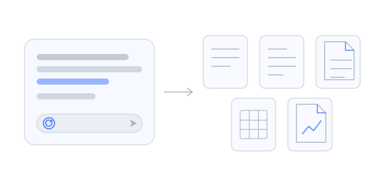

# Pure chat (纯对话)

A selectable DSH agent preset: the conversation goes straight to the model with only three tools — web search, page fetch, and file export.

**Three steps**: create a session → choose “Pure chat” in the preset control → ask. For a file, say “export that as PDF / Excel / Word”.

**Clearing the context** is a separate capability: a control left of the send button resets what the model reads, while the conversation above stays exactly as it was — no message is modified or deleted.

The preset is listed as **Pure chat**, or **纯对话** on a Chinese system.

