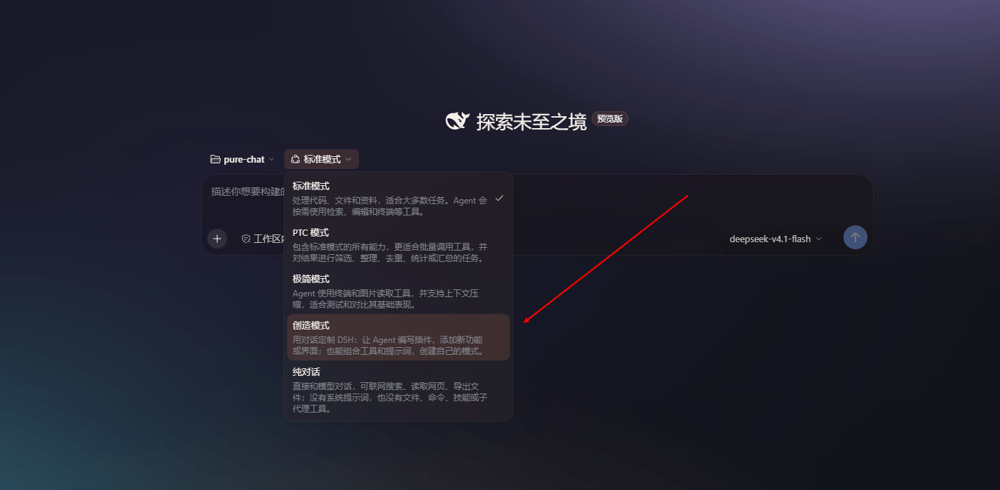

# Pure chat (纯对话)

A plain-chat preset with web search, file export, a clear-context control and a question jumper.

| Feature | What it does |
|---|---|
| Plain chat preset | The conversation goes straight to the model; no system prompt, no host tools. |
| `web_search` / `web_fetch` | Search the web, or fetch one URL as text. |
| `write_file` | Save text as txt, md, doc, xls or pdf. |
| Clear context | A composer button: the model starts fresh, the transcript stays. |
| Question jumper | A session-header dropdown: jump to any earlier question. |

**Three steps**: create a session → choose “Pure chat” → ask.

