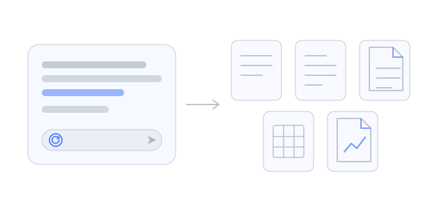

# 纯对话（Pure chat）

一个可选的 DSH 会话预设：对话直接发给模型，只带三个工具——联网搜索、网页读取、文件导出。

**三步上手**：新建会话 → 在预设选择器里选「纯对话」→ 直接提问。需要文件时说「把上面的内容导出成 PDF / Excel / Word」。

**清空上下文**是另一个独立功能：发送按钮左侧的按钮把模型读到的上下文重置为空，而上方已经发生的对话原样保留，不会修改或删除任何历史消息。

预设名称按系统语言显示：中文系统是「纯对话」，其他系统是「Pure chat」。

